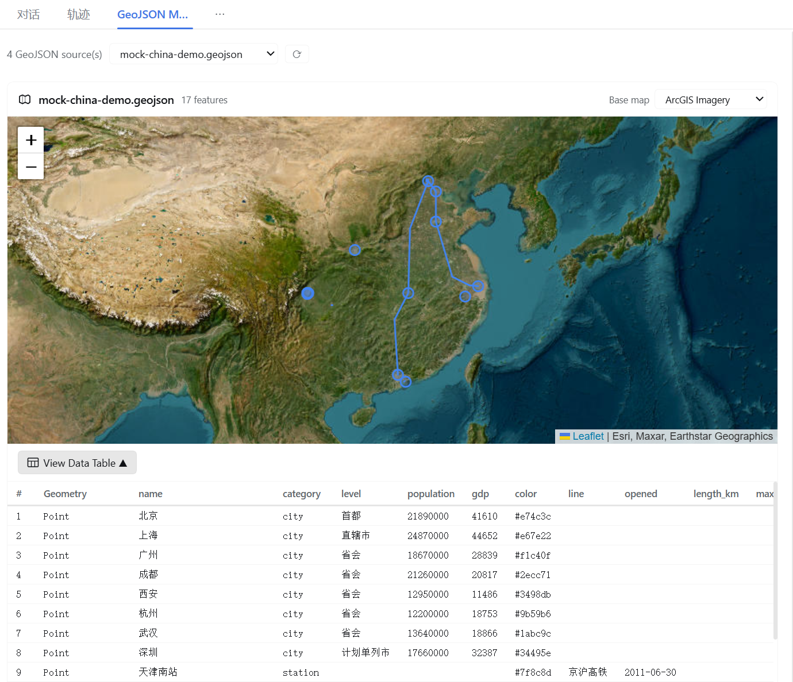

# dsh-geojson-map-viewer

[](https://github.com/deepseek-ai/deepseek-harness)

一个 [DeepSeek Harness](https://github.com/deepseek-ai/deepseek-harness) 插件：把会话中的 GeoJSON 汇聚成交互式 Leaflet 地图视图。

## 功能

- 扫描工作区中的 GeoJSON 文件，在内置地图视图中以下拉列表形式展示，点击即可在地图中查看
- 三个「地图查看」入口：助手消息动作栏、JSON / GeoJSON 代码块、投递（present）的文件卡片
- 助手消息上的动作只在正文出现 GeoJSON 时显示，点一下把这段正文注册成卡片；三个入口重复点击都不会产生重复卡片
- 点击后直接在**右侧边栏**打开地图面板（主视图标签页目前没有插件可调用的切换 API），按钮只做短暂确认、可反复点击
- 底图切换：OpenStreetMap 矢量底图与 ArcGIS 影像底图
- 点击查看要素属性，属性表支持分页（每页 10 / 25 / 50 / 100 行），点击某一行会把地图缩放定位到该行对应的要素并弹出属性
- 地图卡片按会话视图铺满（只保留 16px 边距），不再受固定阅读宽度限制；地图高度随窗口在 360–560px 之间自适应
- 支持全部标准几何类型（Point、MultiPoint、LineString、MultiLineString、Polygon、MultiPolygon、GeometryCollection）
- 自动适配视野范围，最多支持 40 张地图卡片 / 会话，200 个会话
- 会话中消息文本、文件投递、工作区扫描三种来源的 GeoJSON 均自动检测，无需任何配置
- 界面文案跟随客户端语言（中文 / English）切换



## 安装

**从市场安装（推荐）**

在 DSH 插件市场搜索 `dsh-geojson-map-viewer`，点击安装即可。

**从源码安装**

克隆仓库后，在插件源码目录下执行：

```sh
git clone https://github.com/yuexushuang/dsh-geojson-map-viewer.git
cd dsh-geojson-map-viewer
dsh plugin add .
```

## 使用

1. 在会话中处理 GeoJSON 文件（生成、读取或展示）
2. 三个「地图查看」入口，按场景任选：
   - 助手消息正文里出现 GeoJSON 时，消息底部动作栏会多出 **地图查看**
   - JSON / GeoJSON 代码块上方右侧会多出 **地图查看**
   - 投递（present）的 `.geojson` 文件卡片上会多出一个地图图标的按钮
3. 点击后地图直接在右侧边栏打开；按钮显示短暂确认后恢复可点，重复点击只是重新打开同一张卡片
4. 想浏览会话里的全部卡片，仍可打开 **GeoJSON 地图查看器** 视图，从下拉列表选择
5. 在查看器中切换底图、缩放平移，并查看要素属性表

## 依赖

需要一个带 Web 客户端的 [DeepSeek Harness](https://github.com/deepseek-ai/deepseek-harness) 安装。地图服务需要联网。

## 许可证

MIT
